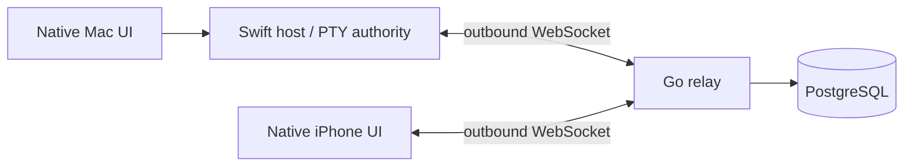

# Architecture

The Mac owns shell processes, byte ordering, terminal dimensions, replay buffers and controller leases. The server authenticates connections and routes messages. It does not execute shells and is not the authority for input ordering. No CRDT or database writes are needed for each keystroke.

A lease contains owner, epoch and last accepted input sequence. Taking control increments the epoch. The host accepts input only from that owner, matching that epoch, with an increasing sequence. Both local and remote input pass through this check on the main actor. Remote leases expire after 30 seconds without renewal/input; iPhone renews every 10 seconds. Disconnect releases control. Taking control is explicit and preempts the previous writer in this POC.

The process stays on the Mac when the network fails. Client output sequence gaps force a new snapshot. Snapshots replay the complete fixed-size stream from process creation; truncating arbitrary ANSI bytes cannot restore a terminal correctly. At the replay cap we therefore refuse another attach. Production needs authoritative terminal-state snapshots and bounded scrollback.

## Storage

| Data | Where | Lifetime |
| --- | --- | --- |
| Host ID / public code / name | PostgreSQL | Until administratively removed |
| Token hashes, revoked status | PostgreSQL | Persistent |
| Temporary pairing secret hash / expiry | PostgreSQL | Consumed once, replaced or expired |
| Raw device credentials | Apple Keychain | Until deleted / replaced |
| PTY processes, ownership, replay | Mac RAM | Host process lifetime |
| Active routes / bounded queues | Relay RAM | Connection lifetime |
| Selected server | Local app preferences | Until changed |

Pairing locks the host row in a transaction, inserts one client, and consumes the secret atomically. Revocation updates PostgreSQL and disconnects an active socket. A second authorization check after socket registration closes the authentication/revocation race. Reconnecting clients must authenticate against the database again.

The initial migration is embedded and applied in a PostgreSQL advisory-locked transaction. Before adding migration 002, introduce ordered migration tracking. Production schema backups and retention policies are also pending.

## Efficiency

One shared Swift package for protocol/networking and one for host responsibilities. Terminal rendering uses SwiftTerm rather than implementing a terminal parser. Go uses an 8-connection database pool and retains live routing in memory. HTTP bodies are capped at 8 KiB, WebSocket messages at 512 KiB, outbound queues at 16 messages, input at 8 KiB and replay at 256 KiB per session. Slow peers are disconnected rather than accumulating unbounded output. These are developer limits, not benchmark results. One relay instance only; no cross-node fanout yet.
