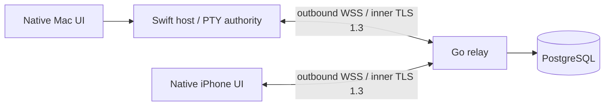

# Architecture

The Mac owns shell processes, byte ordering, terminal dimensions, replay buffers and controller leases. The server authenticates routing credentials and forwards opaque TLS records. The Mac authenticates and authorizes device certificates locally. It does not execute shells and is not the authority for input ordering. No CRDT or database writes are needed for each keystroke.

A lease contains owner, epoch and last accepted input sequence. Taking control increments the epoch. The host accepts input only from that owner, matching that epoch, with an increasing sequence. Both local and remote input pass through this check on the main actor. Remote leases expire after 30 seconds without renewal/input; iPhone renews every 10 seconds. Disconnect releases control. A separate Mac-owned permission layer grants session visibility and temporary control per device; lists and all outgoing session events are filtered. Its five-minute inactivity deadline counts only accepted input after first claim, and cannot be extended by lease renewals or reconnects. Grants are process-local and are cleared on stop/restart; a bounded local event history persists. Taking control is explicit and preempts the previous writer in this POC.

The process stays on the Mac when the network fails. Client output sequence gaps force a new snapshot. Snapshots replay the complete stream of ANSI bytes and ordered geometry changes from process creation; truncating arbitrary ANSI bytes cannot restore a terminal correctly. Updated phones request the disk recording one bounded chunk at a time, acknowledging its file offset before the next read. The host suppresses live output to that phone/session while downloading, refreshes the file length on each request and atomically resumes live events at the final chunk’s output sequence. Each page is authorized again, and transfer IDs reject stale responses after reattachment. Legacy snapshot clients still fail at their replay cap. The Mac app keeps live native renderers across session selection and separately journals ANSI/resize events to owner-only local files. Local reattachment can restore from that journal after network replay overflows. Saved recordings persist until explicitly deleted and are browsed in bounded batches; live renderers retain 10,000 scrollback lines. Production needs authoritative terminal-state snapshots and bounded scrollback.

## Storage

| Data | Where | Lifetime |
| --- | --- | --- |
| Host ID / public code / name | PostgreSQL | Until administratively removed |
| Token hashes, revoked status | PostgreSQL | Persistent |
| Enrollment capability hash / expiry / attempts and trusted certificates | Mac Keychain | Atomic single-use enrollment / local revocation |
| Raw device credentials | Apple Keychain | Until deleted / replaced |
| PTY processes, ownership, replay | Mac RAM | Host process lifetime |
| Active routes / bounded queues | Relay RAM | Connection lifetime |
| Selected server | Local app preferences | Until changed |

Pairing atomically updates the Mac Keychain trust state before acknowledgment. The relay client registration is routing-only. Revocation updates local trust and disconnects the peer before updating PostgreSQL. A second authorization check after socket registration closes the authentication/revocation race. Reconnecting clients must authenticate against the database again.

The initial migration is embedded and applied in a PostgreSQL advisory-locked transaction. Before adding migration 002, introduce ordered migration tracking. Production schema backups and retention policies are also pending.

## Efficiency

One shared Swift package for protocol/networking and one for host responsibilities. Terminal rendering uses SwiftTerm rather than implementing a terminal parser. Go uses an 8-connection database pool and retains live routing in memory. HTTP bodies are capped at 8 KiB, WebSocket messages at 64 KiB, decrypted application packets at 512 KiB, outbound queues at 16 messages, input at 8 KiB and legacy in-memory replay at 256 KiB per session. Disk history transfers use 32 KiB read batches (plus at most one record) and one outstanding request per phone. Slow peers are disconnected rather than accumulating unbounded output. These are developer limits, not benchmark results. One relay instance only; no cross-node fanout yet.
